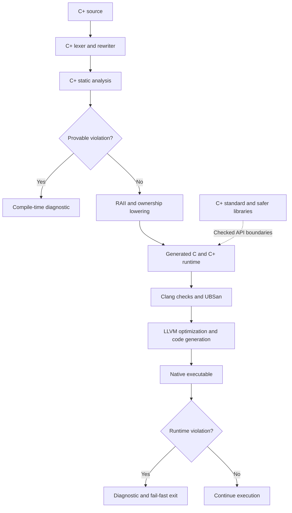
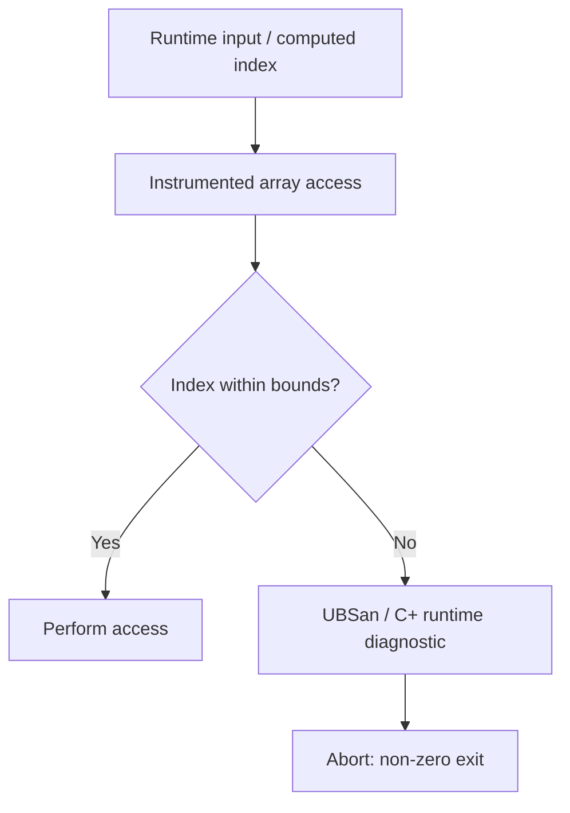

<!-- C+ project README -->
<h1 align="center">C+</h1>

<p align="center">
  
</p>

<p align="center">
  <strong>The safest next version C++ never shipped.</strong><br>
  An experimental C-compatible language focused on compiler-assisted safety and native performance.
</p>

<p align="center">
  <a href="https://github.com/haseeb-heaven/c-plus/stargazers"></a>
  <a href="https://github.com/haseeb-heaven/c-plus/blob/develop/LICENSE"></a>
  
  
</p>

---

C+ ships **Nuklear** and **microui** as standard immediate-mode GUI libraries (MIT-licensed, vendored with their licenses). See [docs/GFX_LIBRARIES.md](docs/GFX_LIBRARIES.md).

## 🆕 New alpha release - try it out

**C+ 0.2.0-alpha is released.** A prebuilt macOS arm64 binary is attached
to the [GitHub pre-release](https://github.com/haseeb-heaven/c-plus/releases/tag/v0.2.0-alpha).
Download, extract, add bin/ to PATH, run c+ --version, and build a .cp file.
Linux and Windows are source-build / compile-only CI today; see platform
status in docs/LIMITATIONS.md. Feedback and issue reports are welcome on
[Issue #22](https://github.com/haseeb-heaven/c-plus/issues/22) and
[PR #17](https://github.com/haseeb-heaven/c-plus/pull/17).

```sh
tar -xzf cplus-alpha-macos-arm64-v020.tar.gz
cd cplus-alpha-release2 && export PATH=$PWD/bin:$PATH
c+ --version   # C+ 0.2.0
```

## ✨ What is C+?

C+ keeps familiar C syntax and adds compiler-assisted safety checks, deterministic resource cleanup, managed allocation, and a growing standard-library layer.

## 🛡️ Safety architecture

C+ applies checks at more than one stage. The compiler rejects violations it can prove before execution. Runtime instrumentation catches supported violations that depend on values only known while the program runs. Safer library interfaces add checks at API boundaries.



### 1. Compile-time safety — C+ analysis + Clang

Before native code generation, C+ rewrites its language extensions and runs static checks. Its current checks include:

- Provable constant and supported counted-loop out-of-bounds array accesses.
- Supported provable null dereferences.
- Ownership copies, use-after-move and borrowed-pointer escape checks.
- Selected Clang diagnostics promoted to errors, such as array bounds and uninitialized reads.
- Deterministic cleanup insertion for supported resource scopes.

Clang handles C parsing, type checking and diagnostics. LLVM handles optimization and native code generation. **LLVM is not, by itself, a proof that a program is memory-safe.**

### 2. Runtime safety — instrumentation + C+ runtime

Some invalid values cannot be known at compile time. Safe builds use Clang's supported sanitizer instrumentation, including undefined-behaviour, bounds, null and alignment checks. The C+ runtime also provides:

- Checked array-index and pointer helpers.
- Managed allocation tracking and allocation-size metadata.
- Detection of managed double-free and invalid release.
- Explicit checks that a managed allocation is still live.
- Reverse-order cleanup for managed allocations and resource destructors.
- Fail-fast diagnostics with deterministic exit codes.



### 3. Standard library and safer APIs

The library layer reduces common risks at the point where programs use APIs:

- `String` uses managed storage and scope cleanup.
- `IntVec` tracks length and capacity.
- Format-free `print` / `scan` helpers reduce format-string mistakes; string input is bounded.
- Checked library functions validate supported sizes, arguments and operation results.

The standard library and hardened libc are **in progress**, not a complete ISO C replacement. Library checks complement compiler analysis; they do not make arbitrary raw pointers safe. See [Issue #22](https://github.com/haseeb-heaven/c-plus/issues/22) and [PR #17](https://github.com/haseeb-heaven/c-plus/pull/17).

## 🧪 Safety examples

The following examples show the difference between a violation that can be proven before execution and one that is only known at runtime.

**A. Compile-time rejection — known out-of-bounds loop**

```c
static int grid[4][4];

int main(void) {
    for (int i = 0; i < 20; i++)
        grid[i / 4][i % 4] = i; /* i == 16 reaches grid[4][0] */
    return 0;
}
```

The C+ static-bounds check can determine that the loop reaches row 4 in a four-row array and reports an out-of-bounds compile error. The executable is not produced.

**Compiler output**

```text
c+ demo.cp -o demo
demo.cp:5:13: error: [CPLUS-BOUNDS] out-of-bounds access: index 4 reaches past array 'grid' of length 4
          grid[i / 4][i % 4] = i; /* i == 16 reaches grid[4][0] */
              ^
help: use a bound of grid.len or a smaller index
haseeb-mir@Haseebs-MacBook-Pro scratch %
```

**B. Runtime rejection — index only known during execution**

```c
#include <stdio.h>

static volatile int index_from_runtime = 7;

int main(void) {
    int values[4] = {10, 20, 30, 40};
    printf("valid: %d\\n", values[2]);
    printf("invalid: %d\\n", values[index_from_runtime]);
    puts("This line must not be reached");
    return 0;
}
```

The `volatile` value prevents the compiler from treating the index as a known constant. The program can compile, but the instrumented runtime detects the invalid index and terminates with a diagnostic. The final line must not execute.

**Runtime output**

```text
demo.cp:8:30: runtime error: index 7 out of bounds for type 'int[4]'
SUMMARY: UndefinedBehaviorSanitizer: undefined-behavior demo.cp:8:30
valid: 30\\nzsh: abort      ./demo
haseeb-mir@Haseebs-MacBook-Pro scratch %
```

### Safety path at a glance

| Stage | Example | Expected result |
|:--|:--|:--|
| Compile time | Counted loop provably reaches `grid[4]` | Compilation rejected |
| Runtime | Volatile index is `7` for a 4-element array | Runtime diagnostic and abort |
| Library boundary | Checked API receives an invalid size | Rejected where that API implements the check |

> [!WARNING]
> **Experimental software — not a blanket memory-safety guarantee.** General use-after-free detection, complete pointer-arithmetic checking, full borrow checking, and complete ISO C coverage are not implemented. Raw C pointers and legacy C operations can still be unsafe. AddressSanitizer is not enabled in the documented macOS environment because its runtime fails during initialization. See [limitations](docs/LIMITATIONS.md).

## Why C+ is not just strict C

Strict C catches syntax and type errors. C+ adds **compile-time proof**,
**runtime guards**, and a **no-heap datastack model inspired by GooseLang**:
scoped arenas with one-store release, so most code never calls malloc.

| # | Example | Caught by | Result |
|---|---|---|---|
| 1 | `arr[20]` on `int arr[4]` | compile-time | `[CPLUS-BOUNDS]` error, no binary |
| 2 | `str[0xFFFFF]` on a string literal | compile-time | bounds error (proven extent) |
| 3 | `p = malloc(8); free(p); *p` | compile+runtime | `[CPLUS-FREE]` refusal, trap 104 |
| 4 | datastack frame overflow | runtime | chained block, never overflows |
| 5 | view after arena `reset()` | runtime | stale token -> lifetime refusal |

**1. Compile-time bounds**

```c
int a[4];
a[20] = 1;   // error: [CPLUS-BOUNDS] index 20 outside bounds of a
```

**2. String-literal extent**

```c
const char *s = "Heaven";
printf("%c", s[0xFFFFF]); // error: index outside string literal extent
```

**3. Use after free**

```c
int *p = cplus_new(int);
cplus_free(p);
*p = 3;  // [CPLUS-FREE] pointer already released (exit 104)
```

**4. Datastack arena (no heap, GooseLang-style)**

```c
#include "stdlib/scoped_mem.hp"
stdlib_datastack ds;
stdlib_datastack_init(&ds, 4096, &err);
stdlib_scratch_scope s = stdlib_scratch_scope(&ds);
void *p = stdlib_datastack_alloc(&ds, 64, 16, &err); // bump, no malloc
s.drop();  // one-store rewind + 0xDD poison in debug
```

**5. Stale view after reset**

```c
stdlib_arena_reset(&a, &err);
if (v.is_live()) ... // false: token retired at reset
```

## 📚 Examples index

- [CLI + web + SQL apps](apps/README.md) and [games/GUI](proof/games_apps/README.md)
- [raylib 2D + real GPU 3D](examples/raylib_demos/README.md)
- [Nuklear GUI](examples/nuklear_gui/README.md) and [microui calculator + notes](examples/microui/README.md)
- [olive.c 2D software renderer](examples/modern_c_ports/olive_demo/README.md)
- [All proof evidence](proof/README.md) - real SDL3 framebuffer PNGs, not CLI transcripts

## 🚀 Quick start

**Requirements:** CMake, a C++20 compiler, and LLVM/Clang development packages.

```sh
cmake -S . -B build
cmake --build build --target c+ -- -j4
./build/c+ build apps/legacy_demos/A_hello.c -o hello
./hello
```

### CLI

| Command | Action |
|:--|:--|
| `./build/c+ build file.c -o app` | Compile |
| `./build/c+ run file.c -o app` | Build and run |
| `./build/c+ check file.c` | Check source |
| `./build/c+ test` | Run tests |
| `./build/c+ demos` | Run demos |
| `./build/c+ bench` | Run benchmarks |

## 📊 Development status

| Component | Status |
|:--|:--|
| Compile-time checks | 🟡 Implemented for a documented subset |
| Runtime checks | 🟡 UBSan + C+ runtime checks |
| RAII and managed memory | 🟡 Implemented with documented limits |
| Standard / safer libraries | 🟡 Partial; expanding |
| Strict safe mode | 🚧 Enforcement and coverage in progress |

> **Honest scope.** The standard library and hardened libc are **in progress**,
> not a complete ISO C replacement. Library checks **complement** compiler
> analysis; they do **not** make arbitrary raw pointers safe. C+ is an
> experimental C-compatible language, not a proof of full memory safety.
> Details and open work: [Issue #22](https://github.com/haseeb-heaven/c-plus/issues/22)
> and [PR #17](https://github.com/haseeb-heaven/c-plus/pull/17).


### Current work

- [Compiler development · Issue #21](https://github.com/haseeb-heaven/c-plus/issues/21) · [PR #16](https://github.com/haseeb-heaven/c-plus/pull/16)
- [Hardened library · Issue #22](https://github.com/haseeb-heaven/c-plus/issues/22) · [PR #17](https://github.com/haseeb-heaven/c-plus/pull/17)
- [Verification and release gate · Issue #23](https://github.com/haseeb-heaven/c-plus/issues/23)

## 🧪 Verify

```sh
./tests/run_tests.sh
./apps/legacy_demos/run_demos.sh
./benchmarks/run_bench.sh
```

Passing tests do not prove general memory safety. Review the [status](docs/STATUS.md), [limitations](docs/LIMITATIONS.md), [architecture](docs/ARCHITECTURE.md), and [roadmap](docs/ROADMAP.md).

## 🤖 AI-assisted development

AI assistants were used in the implementation of this project. Heaven created the language design and vision, directed all technical decisions, and personally reviewed and tested the work. AI-assisted code remains subject to the same review, regression tests, and verification gates as hand-written code; no claim of autonomous correctness is made.

## 🤝 Contributing

See [CONTRIBUTING.md](CONTRIBUTING.md) and [LICENSE](LICENSE).

## ⚡ Benchmarks and proof — faster + safer standard/safer libs

All figures below are **measured on this host** with bounded runners; they are
not language-equivalence claims. Full narrative:
[`docs/stdlib/MODERN_SAFER_EVIDENCE.md`](docs/stdlib/MODERN_SAFER_EVIDENCE.md).

| Measurement | Result | Meaning |
|---|---|---|
| scoped-memory-style data-stack bump vs checked heap (`sh benchmarks/scoped_bump/run.sh`) | **30 ns/op vs 328 ns/op** in the committed evidence run (~10.9× lower allocation latency) | [binary + raw output + screenshot](proof/benchmarks/README.md). `stdlib/datastack.hp` bump + one-store scope release. Gate `BENCH_SCOPED 4 4 0`. |
| Modern libs on scratch (`sh benchmarks/scoped_apps/run.sh`) | **23 ns/op bump vs 206 ns/op heap** (~9.0×); full workload 146 ns/op in the [committed evidence](proof/benchmarks/README.md) | Real app-shaped workload, gate `SCOPED_APPS_BENCH 3 3 0`. |
| Checked-heap tracking ON/OFF | 2.59× median overhead (79.91 vs 30.85 ns/op) | Cost of the live-allocation side table; the reason hot paths use arenas/pools instead. |
| Rust-vs-C+ runtime outcomes (`sh tests/rust_vs_cplus/run_compare.sh`) | 473 matched, 119 documented differences, 8 both-skip, **0 failures** | Outcome parity on valid inputs is evidence of behavior, **not** a speed or safety proof. |
| Fil-C-style liveness / SoftBound / GSL / lifetime (`sh tests/stdlib/upstream_reuse/run_memory_safety.sh`) | `MEMSAFE 5 5 0` (26 + 51 + 80 + 25 checks) | Adapted side-table/bounds techniques only; no Fil-C compiler, GC or capability ABI, and no timing comparison. |
| Adversarial refusals | `EDGE1000 24797 24797 0`, `libc 109/109`, attack 22/22, fuzz 4800 cases | Counts of exercised refusal/boundary cases — not a 100% safety proof. |

**Real apps/games, end to end:** `APPS 3 3 0` (web server via curl, SQL-like
DB, headless game engine), `GAME_SUITE 4 4 0` (snake, maze, Nuklear UI + SVG
screenshots), `CROSS_PROOF 58 58 0` (Mach-O + PE32+), `PORTS_MODERN_C 16 16 0`.
Screenshots and per-app proof pages:
[`proof/all_apps_games_screenshots/README.md`](proof/all_apps_games_screenshots/README.md).

The core rule is documented in
[`docs/CORE_PHILOSOPHY.md`](docs/CORE_PHILOSOPHY.md): arena-first, one-store
release, no moving live data, refuse-don't-trust, opt-in no-heap mode, and
measurement instead of equivalence claims.

## Design provenance

C+ is **mostly inspired by Fil-C, the C3 language and the Goose language**:
Fil-C for out-of-band pointer validity with an unchanged C pointer ABI, C3 for
modern C-compatible syntax and diagnostic style, and Goose for safe-systems
ergonomics and the cross-language benchmark reference. GooseLang lives at <https://github.com/aardappel/goose> (Apache-2.0) and
supplied the scoped/arena ideas; TrapC and Rust are
referenced as safety models, not as code sources.

No source from those projects was copied unless vendored with its own license
(see proof/benchmarks/README.md for cross-language data and
docs/security/upstream-techniques.md for source-cited Fil-C notes). This is
not a claim of equivalence to any of them, nor of 100% memory safety. Full
details: docs/DESIGN_PROVENANCE.md.
