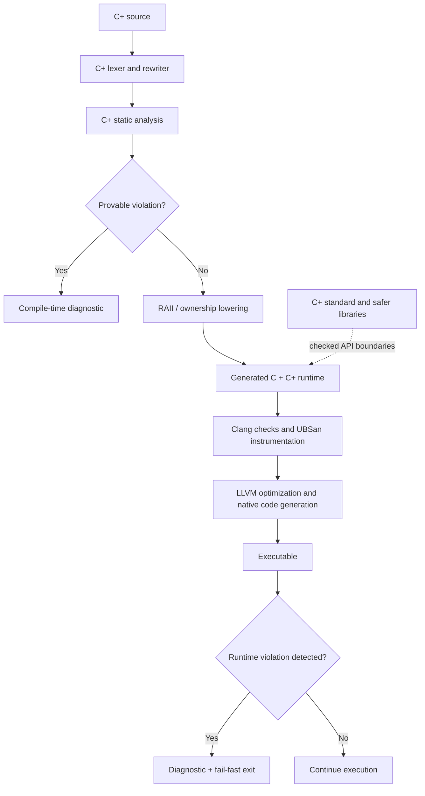
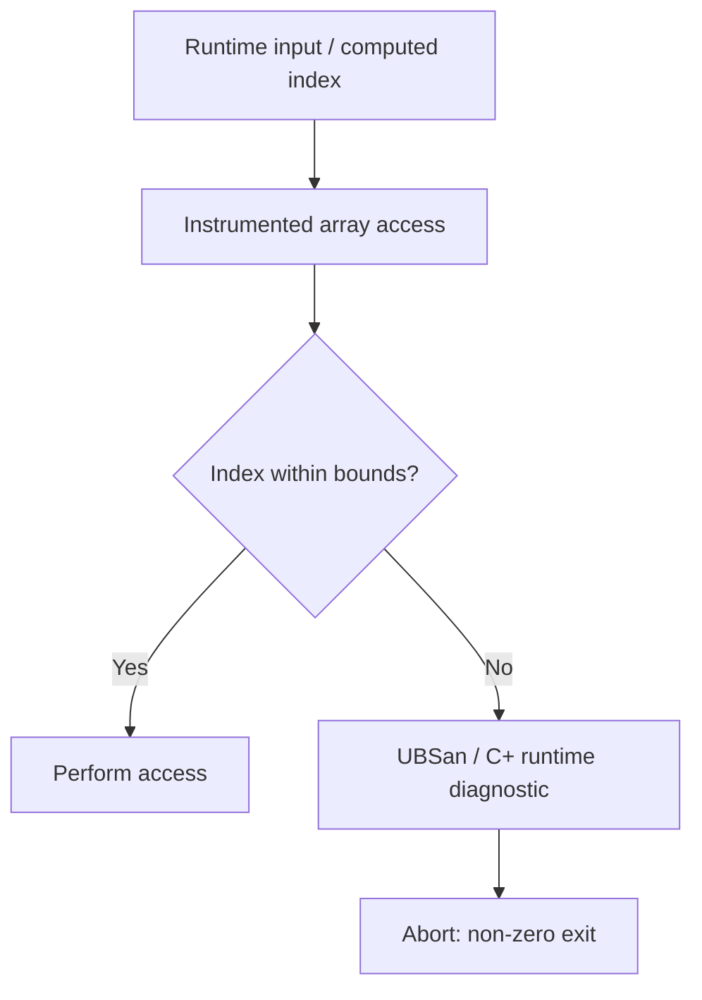

<!-- C+ project README -->
<h1 align="center">C+</h1>

<p align="center">
  
</p>

<p align="center">
  <strong>The safest next version C++ never shipped.</strong><br>
  An experimental C-compatible language focused on compiler-assisted safety and native performance.
</p>

<p align="center">
  <a href="https://github.com/haseeb-heaven/c-plus/stargazers"></a>
  <a href="https://github.com/haseeb-heaven/c-plus/blob/develop/LICENSE"></a>
  
  
</p>

---

## ✨ What is C+?

C+ keeps familiar C syntax and adds compiler-assisted safety checks, deterministic resource cleanup, managed allocation, and a growing standard-library layer.

## 🛡️ Safety architecture

C+ applies checks at more than one stage. The compiler rejects violations it can prove before execution. Runtime instrumentation catches supported violations that depend on values only known while the program runs. Safer library interfaces add checks at API boundaries.



### 1. Compile-time safety — C+ analysis + Clang

Before native code generation, C+ rewrites its language extensions and runs static checks. Its current checks include:

- Provable constant and supported counted-loop out-of-bounds array accesses.
- Supported provable null dereferences.
- Ownership copies, use-after-move and borrowed-pointer escape checks.
- Selected Clang diagnostics promoted to errors, such as array bounds and uninitialized reads.
- Deterministic cleanup insertion for supported resource scopes.

Clang handles C parsing, type checking and diagnostics. LLVM handles optimization and native code generation. **LLVM is not, by itself, a proof that a program is memory-safe.**

### 2. Runtime safety — instrumentation + C+ runtime

Some invalid values cannot be known at compile time. Safe builds use Clang's supported sanitizer instrumentation, including undefined-behaviour, bounds, null and alignment checks. The C+ runtime also provides:

- Checked array-index and pointer helpers.
- Managed allocation tracking and allocation-size metadata.
- Detection of managed double-free and invalid release.
- Explicit checks that a managed allocation is still live.
- Reverse-order cleanup for managed allocations and resource destructors.
- Fail-fast diagnostics with deterministic exit codes.



### 3. Standard library and safer APIs

The library layer reduces common risks at the point where programs use APIs:

- `String` uses managed storage and scope cleanup.
- `IntVec` tracks length and capacity.
- Format-free `print` / `scan` helpers reduce format-string mistakes; string input is bounded.
- Checked library functions validate supported sizes, arguments and operation results.

The standard library and hardened libc are **in progress**, not a complete ISO C replacement. Library checks complement compiler analysis; they do not make arbitrary raw pointers safe. See [Issue #22](https://github.com/haseeb-heaven/c-plus/issues/22) and [PR #17](https://github.com/haseeb-heaven/c-plus/pull/17).

## 🧪 Safety examples

The following examples show the difference between a violation that can be proven before execution and one that is only known at runtime.

**A. Compile-time rejection — known out-of-bounds loop**

```c
static int grid[4][4];

int main(void) {
    for (int i = 0; i < 20; i++)
        grid[i / 4][i % 4] = i; /* i == 16 reaches grid[4][0] */
    return 0;
}
```

The C+ static-bounds check can determine that the loop reaches row 4 in a four-row array and reports an out-of-bounds compile error. The executable is not produced.

**B. Runtime rejection — index only known during execution**

```c
#include <stdio.h>

static volatile int index_from_runtime = 7;

int main(void) {
    int values[4] = {10, 20, 30, 40};
    printf("valid: %d\\n", values[2]);
    printf("invalid: %d\\n", values[index_from_runtime]);
    puts("This line must not be reached");
    return 0;
}
```

The `volatile` value prevents the compiler from treating the index as a known constant. The program can compile, but the instrumented runtime detects the invalid index and terminates with a diagnostic. The final line must not execute.

### Safety path at a glance

| Stage | Example | Expected result |
|:--|:--|:--|
| Compile time | Counted loop provably reaches `grid[4]` | Compilation rejected |
| Runtime | Volatile index is `7` for a 4-element array | Runtime diagnostic and abort |
| Library boundary | Checked API receives an invalid size | Rejected where that API implements the check |

> [!WARNING]
> **Experimental software — not a blanket memory-safety guarantee.** General use-after-free detection, complete pointer-arithmetic checking, full borrow checking, and complete ISO C coverage are not implemented. Raw C pointers and legacy C operations can still be unsafe. AddressSanitizer is not enabled in the documented macOS environment because its runtime fails during initialization. See [limitations](docs/LIMITATIONS.md).

## 🚀 Quick start

**Requirements:** CMake, a C++20 compiler, and LLVM/Clang development packages.

```sh
cmake -S . -B build
cmake --build build --target c+ -- -j4
./build/c+ build demos/A_hello.c -o hello
./hello
```

### CLI

| Command | Action |
|:--|:--|
| `./build/c+ build file.c -o app` | Compile |
| `./build/c+ run file.c -o app` | Build and run |
| `./build/c+ check file.c` | Check source |
| `./build/c+ test` | Run tests |
| `./build/c+ demos` | Run demos |
| `./build/c+ bench` | Run benchmarks |

## 📊 Development status

| Component | Status |
|:--|:--|
| Compile-time checks | 🟡 Implemented for a documented subset |
| Runtime checks | 🟡 UBSan + C+ runtime checks |
| RAII and managed memory | 🟡 Implemented with documented limits |
| Standard / safer libraries | 🟡 Partial; expanding |
| Strict safe mode | 🚧 Enforcement and coverage in progress |

### Current work

- [Compiler development · Issue #21](https://github.com/haseeb-heaven/c-plus/issues/21) · [PR #16](https://github.com/haseeb-heaven/c-plus/pull/16)
- [Hardened library · Issue #22](https://github.com/haseeb-heaven/c-plus/issues/22) · [PR #17](https://github.com/haseeb-heaven/c-plus/pull/17)
- [Verification and release gate · Issue #23](https://github.com/haseeb-heaven/c-plus/issues/23)

## 🧪 Verify

```sh
./tests/run_tests.sh
./demos/run_demos.sh
./benchmarks/run_bench.sh
```

Passing tests do not prove general memory safety. Review the [status](docs/STATUS.md), [limitations](docs/LIMITATIONS.md), [architecture](docs/ARCHITECTURE.md), and [roadmap](docs/ROADMAP.md).

## 🤖 AI-assisted development

Codex and Gemini assisted with implementation. Heaven created the language design and vision, directed technical decisions, and manually tested the project. AI-assisted code remains subject to review and verification.

## 🤝 Contributing

See [CONTRIBUTING.md](CONTRIBUTING.md) and [LICENSE](LICENSE).
