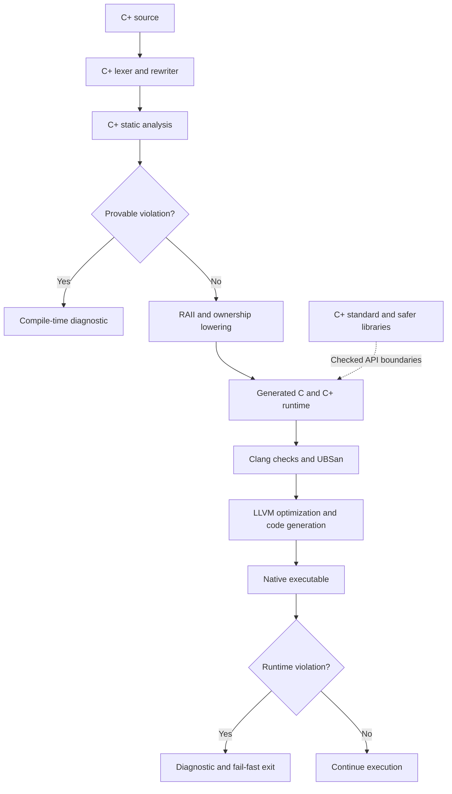
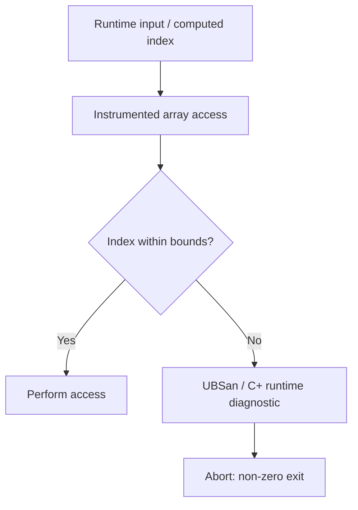
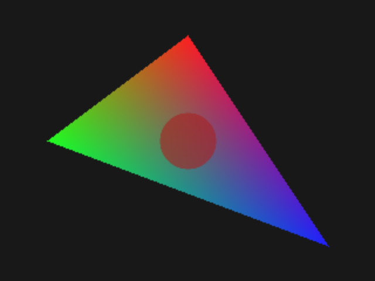

<!-- C+ project README -->
<h1 align="center">C+</h1>

<p align="center">
  
</p>

<p align="center">
  <strong>The safest next version C++ never shipped.</strong><br>
  An experimental C-compatible language focused on compiler-assisted safety and native performance.
</p>

<p align="center">
  <a href="https://github.com/haseeb-heaven/c-plus/stargazers"></a>
  <a href="https://github.com/haseeb-heaven/c-plus/blob/develop/LICENSE"></a>
  
  
</p>

---

C+ ships **Nuklear** and **microui** as standard immediate-mode GUI libraries (MIT-licensed, vendored with their licenses). See [docs/GFX_LIBRARIES.md](docs/GFX_LIBRARIES.md).

## 🆕 New alpha release - try it out

**C+ 0.2.0-alpha is released.** A prebuilt macOS arm64 binary is attached
to the [GitHub pre-release](https://github.com/haseeb-heaven/c-plus/releases/tag/v0.2.0-alpha).
Download, extract, add bin/ to PATH, run c+ --version, and build a .cp file.
Linux and Windows are source-build / compile-only CI today; see platform
status in docs/LIMITATIONS.md. Feedback and issue reports are welcome on
[Issue #22](https://github.com/haseeb-heaven/c-plus/issues/22) and
[PR #17](https://github.com/haseeb-heaven/c-plus/pull/17).

```sh
tar -xzf cplus-alpha-macos-arm64-v020.tar.gz
cd cplus-alpha-release2 && export PATH=$PWD/bin:$PATH
c+ --version   # C+ 0.2.0
```

## ✨ What is C+?

C+ keeps familiar C syntax and adds compiler-assisted safety checks, deterministic resource cleanup, managed allocation, and a growing standard-library layer.

## 🛡️ Safety architecture

C+ applies checks at more than one stage. The compiler rejects violations it can prove before execution. Runtime instrumentation catches supported violations that depend on values only known while the program runs. Safer library interfaces add checks at API boundaries.



### 1. Compile-time safety — C+ analysis + Clang

Before native code generation, C+ rewrites its language extensions and runs static checks. Its current checks include:

- Provable constant and supported counted-loop out-of-bounds array accesses.
- Supported provable null dereferences.
- Ownership copies, use-after-move and borrowed-pointer escape checks.
- Selected Clang diagnostics promoted to errors, such as array bounds and uninitialized reads.
- Deterministic cleanup insertion for supported resource scopes.

Clang handles C parsing, type checking and diagnostics. LLVM handles optimization and native code generation. **LLVM is not, by itself, a proof that a program is memory-safe.**

### 2. Runtime safety — instrumentation + C+ runtime

Some invalid values cannot be known at compile time. Safe builds use Clang's supported sanitizer instrumentation, including undefined-behaviour, bounds, null and alignment checks. The C+ runtime also provides:

- Checked array-index and pointer helpers.
- Managed allocation tracking and allocation-size metadata.
- Detection of managed double-free and invalid release.
- Explicit checks that a managed allocation is still live.
- Reverse-order cleanup for managed allocations and resource destructors.
- Fail-fast diagnostics with deterministic exit codes.



### 3. Standard library and safer APIs

The library layer reduces common risks at the point where programs use APIs:

- `String` uses managed storage and scope cleanup.
- `IntVec` tracks length and capacity.
- Format-free `print` / `scan` helpers reduce format-string mistakes; string input is bounded.
- Checked library functions validate supported sizes, arguments and operation results.

The standard library and hardened libc are **in progress**, not a complete ISO C replacement. Library checks complement compiler analysis; they do not make arbitrary raw pointers safe. See [Issue #22](https://github.com/haseeb-heaven/c-plus/issues/22) and [PR #17](https://github.com/haseeb-heaven/c-plus/pull/17).

## 🧪 Safety examples

The following examples show the difference between a violation that can be proven before execution and one that is only known at runtime.

**A. Compile-time rejection - known out-of-bounds loop**

```c
static int grid[4][4];

int main(void) {
    for (int cell_index = 0; cell_index < 20; cell_index++) {
        grid[cell_index / 4][cell_index % 4] = cell_index;
    }
    return 0;
}
```

The C+ static-bounds check proves that the loop reaches row 4 in a four-row
array and reports an out-of-bounds compile error. No executable is produced.

**Compiler output**

```text
c+ demo.cp -o demo
demo.cp:5:13: error: [CPLUS-BOUNDS] out-of-bounds access: index 4 reaches past array 'grid' of length 4
          grid[cell_index / 4][cell_index % 4] = cell_index;
              ^
help: use a bound of grid.len or a smaller index
```

**B. Runtime rejection - index only known during execution**

```c
#include <stdio.h>

static volatile int runtime_index = 7;

int main(void) {
    int values[4] = { 10, 20, 30, 40 };

    printf("valid: %d\n", values[2]);
    printf("invalid: %d\n", values[runtime_index]);
    puts("This line must not be reached");
    return 0;
}
```

The `volatile` value prevents the compiler from treating the index as a
known constant. The program compiles, but the instrumented runtime detects
the invalid index and terminates with a diagnostic; the final line never
executes.

**Runtime output**

```text
demo.cp:10:30: runtime error: index 7 out of bounds for type 'int[4]'
SUMMARY: UndefinedBehaviorSanitizer: undefined-behavior demo.cp:10:30
valid: 30
Abort trap: 6
```

## Why C+ is not just strict C

Strict C catches syntax and type errors. C+ adds **compile-time proof**,
**runtime guards**, and a **no-heap datastack model inspired by GooseLang**:
scoped arenas with one-store release, so most code never calls malloc.

| # | Example | Caught by | Result |
|---|---|---|---|
| 1 | `values[20]` on `int values[4]` | compile-time | `[CPLUS-BOUNDS]` error, no binary |
| 2 | `message[0xFFFFF]` on a string literal | compile-time | bounds error (proven extent) |
| 3 | `item` used after `cplus_free(item)` | compile + runtime | `[CPLUS-FREE]` refusal, trap 104 |
| 4 | datastack frame overflow | runtime | chained block, never overflows |
| 5 | view after arena reset | runtime | stale token fails `stdlib_view_validate` |

**1. Compile-time bounds**

```c
int values[4] = { 0 };
const int index = 20;

values[index] = 1;
/* error: [CPLUS-BOUNDS] index 20 outside bounds of 'values' */
```

**2. String-literal extent**

```c
#include <stdio.h>

const char *message = "Heaven";
const int offset = 0xFFFFF;

printf("%c\n", message[offset]);
/* error: index outside the proven extent of the string literal */
```

**3. Use after free**

```c
#include "cplus/cplus.h"

int *item = cplus_new(int);

cplus_free(item);
*item = 3;   /* [CPLUS-FREE] pointer already released (exit 104) */
```

**4. Datastack arena (no heap, GooseLang-style)**

```c
#include "stdlib/datastack.hp"
#include "stdlib/scoped_mem.hp"

error status = error();
stdlib_datastack arena;

stdlib_datastack_init(&arena, 4096u, &status);
stdlib_scratch_scope scope = stdlib_scratch_scope(&arena);

unsigned char *buffer =
    (unsigned char *)stdlib_datastack_alloc(&arena, 64u, 16u, &status);

scope.drop();   /* one-store rewind; 0xDD poison in debug */
```

**5. Stale view after reset**

```c
#include "stdlib/arena.hp"
#include "stdlib/view_lifetime.hp"

error status = error();
stdlib_arena arena;
unsigned char *view;
unsigned long long token = 0;

stdlib_arena_init(&arena, 128u, &status);
view = stdlib_arena_take_checked(&arena, 32u, 16u, &token, &status);

stdlib_arena_destroy(&arena, &status);
if (stdlib_view_validate(view, token) == 0) {
    /* false: the reset retired the token */
}
```

## Why choose C+

- **Same C source:** `.cp` files stay C-compatible; `LEGACY` keeps your bytes unchanged. Existing C libraries link as-is.
- **Same C ABI:** `sizeof`/`alignof` of C structs, unions and raw pointers never change. Metadata lives in side tables, so raylib/Nuklear/SDL3 just work.
- **Compile-time + runtime safety:** proven bounds/lifetime diagnostics before execution, then runtime guards and a live-pointer table after it.
- **Not Rust-style safety:** borrow checking would need pointer/layout changes and break the C ABI. C+ uses GooseLang-style side tables and scoped arenas instead.
- **No heap by default:** datastack arenas bump-allocate and rewind with one store; RAII `drop()` is deterministic. No GC, no malloc on the hot path.
- **Fast where it counts:** measured bump allocation `23-30 ns/op` vs checked heap `206-328 ns/op`. Guards have a cost (`--release --sanitize=none` opts out); see [benchmarks](proof/benchmarks/README.md).

## Comparison: C+ vs C3, Fil-C, Zig

| Aspect | C+ | C3 | Fil-C | Zig |
|---|---|---|---|---|
| Runtime safety | guards + live table, no GC | opt-in bounds/checks | invisible capabilities (side tables) + GC | optional safety checks (disablable) |
| Compile-time | proven diagnostics, STRICT gate | contracts, contracts in types | LLVM-based static checks | comptime, compile-time evaluation |
| RAII | deterministic `class` + `drop()` | `defer`, scoped | GC-managed | `defer`/`errdefer` (manual) |
| Speed (this host) | 2.743 ns/iter (heavy, c+ release) | NOT_TESTED | NOT_TESTED | 3.121 ns/iter (heavy) |
| Safety model | heap-free datastacks + guards | modern C-like, contracts | capability pointers, unchanged `sizeof(T*)` | manual ownership + optional checks |
| C source preserved | yes (`.cp`, `LEGACY` keeps bytes) | no (new syntax) | yes (compiles C) | no (new syntax) |
| C ABI preserved | yes (`sizeof`/`alignof` fixed) | C interop only | yes (8-byte pointers) | C interop only |
| Parameters/generics | `Vec(T)`/`Slice(T)` + C wrappers | generics | C macros | `comptime` generics |

C3/Fil-C binaries are absent here, so speed is `NOT_TESTED` - never fabricated.
Full data: [benchmarks](proof/benchmarks/README.md).

## 📚 Examples index

- [CLI + web + SQL apps](apps/README.md) and [games/GUI](proof/games_apps/README.md)
- [raylib 2D + real GPU 3D](examples/raylib_demos/README.md)
- [Nuklear GUI](examples/nuklear_gui/README.md) and [microui calculator + notes](examples/microui/README.md)
- [olive.c 2D software renderer](examples/modern_c_ports/olive_demo/README.md)
- [All proof evidence](proof/README.md) - real SDL3 framebuffer PNGs, not CLI transcripts

## GUI demos - real libraries, real C ABI




| Demo | C source stays C | Library form | Gate |
|---|---|---|---|
| [Nuklear](examples/nuklear_gui/README.md) | `third_party/nuklear/nuklear_impl.c` + C backend | static C objects + dynamic SDL3 | `NUKLEAR_GUI_TEST 7 7 0` |
| [microui](examples/microui/README.md) | `stdlib/microui/microui.c` + C backend | static C objects + dynamic SDL3 | `MICROUI_TEST 6 6 0` |
| [Olive](examples/modern_c_ports/olive_demo/README.md) | `olive.c` via `c+ --legacy-c` | static `.a` or dynamic `.dylib` | `OLIVE_SDL_TEST 6 6 0` |

All three keep C `sizeof`/`alignof` unchanged, link prebuilt C libraries
directly, and capture real framebuffer screenshots - not CLI transcripts.
The [raylib demos](examples/raylib_demos/README.md) additionally prove both
`libraylib.a` (static) and `libraylib.6.2.0.dylib` (dynamic) work unchanged.

## 🚀 Quick start

**Requirements:** CMake, a C++20 compiler, and LLVM/Clang development packages.

```sh
cmake -S . -B build
cmake --build build --target c+ -- -j4
./build/c+ build apps/legacy_demos/A_hello.c -o hello
./hello
```

### CLI

| Command | Action |
|:--|:--|
| `./build/c+ build file.c -o app` | Compile |
| `./build/c+ run file.c -o app` | Build and run |
| `./build/c+ check file.c` | Check source |
| `./build/c+ test` | Run tests |
| `./build/c+ demos` | Run demos |
| `./build/c+ bench` | Run benchmarks |

## 📊 Development status

| Component | Status |
|:--|:--|
| Compile-time checks | 🟡 Implemented for a documented subset |
| Runtime checks | 🟡 UBSan + C+ runtime checks |
| RAII and managed memory | 🟡 Implemented with documented limits |
| Standard / safer libraries | 🟡 Partial; expanding |
| Strict safe mode | 🚧 Enforcement and coverage in progress |

> **Honest scope.** The standard library and hardened libc are **in progress**,
> not a complete ISO C replacement. Library checks **complement** compiler
> analysis; they do **not** make arbitrary raw pointers safe. C+ is an
> experimental C-compatible language, not a proof of full memory safety.
> Details and open work: [Issue #22](https://github.com/haseeb-heaven/c-plus/issues/22)
> and [PR #17](https://github.com/haseeb-heaven/c-plus/pull/17).


### Current work

- [Compiler development · Issue #21](https://github.com/haseeb-heaven/c-plus/issues/21) · [PR #16](https://github.com/haseeb-heaven/c-plus/pull/16)
- [Hardened library · Issue #22](https://github.com/haseeb-heaven/c-plus/issues/22) · [PR #17](https://github.com/haseeb-heaven/c-plus/pull/17)
- [Verification and release gate · Issue #23](https://github.com/haseeb-heaven/c-plus/issues/23)

## 🧪 Verify

```sh
./tests/run_tests.sh
./apps/legacy_demos/run_demos.sh
./benchmarks/run_bench.sh
```

Passing tests do not prove general memory safety. Review the [status](docs/STATUS.md), [limitations](docs/LIMITATIONS.md), [architecture](docs/ARCHITECTURE.md), and [roadmap](docs/ROADMAP.md).

## 🤖 AI-assisted development

AI assistants were used in the implementation of this project. Heaven created the language design and vision, directed all technical decisions, and personally reviewed and tested the work. AI-assisted code remains subject to the same review, regression tests, and verification gates as hand-written code; no claim of autonomous correctness is made.

## 🤝 Contributing

See [CONTRIBUTING.md](CONTRIBUTING.md) and [LICENSE](LICENSE).

## ⚡ Benchmarks and proof (measured, this host)

Every number below is from a bounded runner on this host; raw output,
binaries and screenshots are in [`proof/benchmarks/README.md`](proof/benchmarks/README.md).
Not language-equivalence claims.

### Allocation - clear winner: datastack bump

| Method | Time |
|---|---:|
| Datastack bump (`benchmarks/scoped_bump`) | **30 ns/op** |
| Checked heap, same workload | 328 ns/op |
| Datastack bump (`benchmarks/scoped_apps`) | **23 ns/op** |
| Checked heap, same workload | 206 ns/op |

Bump wins by ~9-11x. Cost of the live-allocation side table: 2.59x median
(79.91 vs 30.85 ns/op) - why hot paths use arenas/pools.

### Head-to-head - 2M iterations, checksum `16776346274400` verified on every binary

| Toolchain | Compile | Runtime | ns/iter |
|---|---:|---:|---:|
| Rust `-O` | 796 ms | **2,208,084 ns** | **1.104** (fastest runtime) |
| Goose native (`goose build`) | **220 ms** (fastest compile) | 2,486,000 ns | 1.243 |
| Zig `ReleaseFast` | 6710 ms | 2,530,000 ns | 1.265 |
| C+ `--release --sanitize=none` | 1364 ms | 3,604,000 ns | 1.802 |
| C+ `--default` (guards on) | 1017 ms | 18,780,000 ns | 9.390 |

Heavy 200M-iteration loop (checksum `1677765674676096`): C `1.948`,
Goose `2.061`, C+ release `2.743`, Zig `3.121`, Rust `3.744` ns/iter -
different workload, different winner. C+ default pays for runtime guards;
`--release --sanitize=none` removes them. Fil-C/TrapC binaries absent =
`NOT_TESTED`, never a fabricated number.

### Evidence and correctness gates (not speed)

- Rust-vs-C+ outcomes: `473 matched, 119 documented differences, 0 failures`.
- Memory-safety techniques: `MEMSAFE 5 5 0` (side tables/bounds only, no GC).
- Adversarial refusals: `EDGE1000 24797 24797 0`, `libc 109/109`, attack `22/22`, fuzz `4800`.
- Real apps/games: `APPS 3 3 0`, `GAME_SUITE 4 4 0`, `CROSS_PROOF 58 58 0`, `PORTS_MODERN_C 16 16 0`.

Screenshots: [`proof/all_apps_games_screenshots/README.md`](proof/all_apps_games_screenshots/README.md).
Philosophy: [`docs/CORE_PHILOSOPHY.md`](docs/CORE_PHILOSOPHY.md).

## Design provenance

C+ is **mostly inspired by Fil-C, the C3 language and the Goose language**:
Fil-C for out-of-band pointer validity with an unchanged C pointer ABI, C3 for
modern C-compatible syntax and diagnostic style, and Goose for safe-systems
ergonomics and the cross-language benchmark reference. GooseLang lives at <https://github.com/aardappel/goose> (Apache-2.0) and
supplied the scoped/arena ideas; TrapC and Rust are
referenced as safety models, not as code sources.

No source from those projects was copied unless vendored with its own license
(see proof/benchmarks/README.md for cross-language data and
docs/security/upstream-techniques.md for source-cited Fil-C notes). This is
not a claim of equivalence to any of them, nor of 100% memory safety. Full
details: docs/DESIGN_PROVENANCE.md.
Upstream licenses and vendored-library provenance: [docs/libc/SAFER_UPSTREAM_INTEGRATION.md](docs/libc/SAFER_UPSTREAM_INTEGRATION.md).
