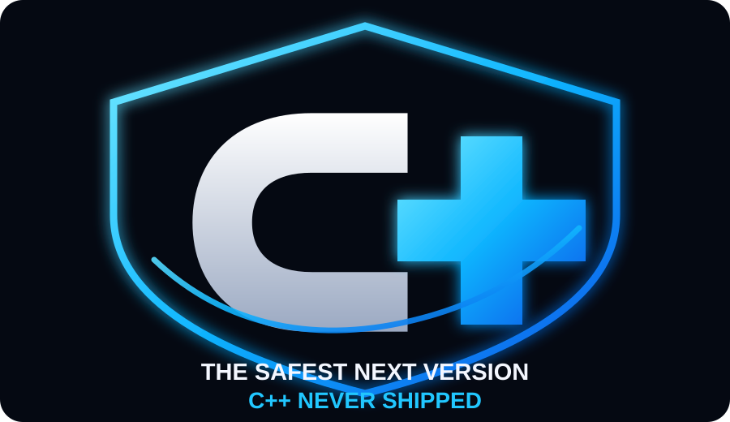

# C+

<p align="center">
  
</p>

<p align="center"><strong>The safest next version C++ never shipped.</strong></p>

C+ is an experimental C-compatible language and toolchain. Its goal is to combine familiar C syntax and native performance with compiler-driven memory-safety analysis and a bundled hardened C library.

> **Status:** Experimental. The safety design is a goal, not a completed guarantee. Compatibility mode is not memory-safe by default. Strict safe mode must reject operations it cannot prove safe or enforce soundly.

## What C+ aims to provide

- **Compiler:** infer ownership, lifetimes, aliases and bounds; diagnose unsafe operations; provide a fail-closed strict mode.
- **C ergonomics:** keep familiar C syntax. No mandatory borrow annotations or Rust-style ownership syntax.
- **Optional features:** RAII and struct-backed methods.
- **Hardened library:** bundled C library implementations, public headers and selected checked `*_s` APIs.
- **Native output:** use Clang/LLVM and preserve supported C ABI compatibility.

C+ does not currently guarantee Rust-equivalent safety for arbitrary C programs, zero runtime overhead, or complete ISO C library coverage. See [limitations](docs/LIMITATIONS.md).

## Quick start

**Requirements:** CMake, a C++20 compiler, and LLVM/Clang development packages.

```sh
cmake -S . -B build
cmake --build build --target c+ -- -j4
./build/c+ build demos/A_hello.c -o hello
./hello
```

Useful commands:

| Command | Purpose |
| --- | --- |
| `./build/c+ build file.c -o app` | Compile |
| `./build/c+ run file.c -o app` | Build and run |
| `./build/c+ check file.c` | Check source |
| `./build/c+ test` | Run tests |
| `./build/c+ demos` | Run demos |
| `./build/c+ bench` | Run benchmarks |

## Project status

| Area | Current direction |
| --- | --- |
| Compiler safety | In development; ownership and alias analysis are incomplete |
| RAII and classes | Partial implementation; control-flow and integration gaps remain |
| Standard library | Partial implementation; not a complete ISO C replacement |
| Strict safe mode | Must fail closed where safety cannot be proven or soundly checked |

Work is tracked in:
- [Compiler issue #21](https://github.com/haseeb-heaven/c-plus/issues/21) · [PR #16](https://github.com/haseeb-heaven/c-plus/pull/16)
- [Hardened library issue #22](https://github.com/haseeb-heaven/c-plus/issues/22) · [PR #17](https://github.com/haseeb-heaven/c-plus/pull/17)
- [Verification and release gate #23](https://github.com/haseeb-heaven/c-plus/issues/23)

## Verify

```sh
./tests/run_tests.sh
./demos/run_demos.sh
./benchmarks/run_bench.sh
```

Passing tests do not prove general memory safety. Review [STATUS](docs/STATUS.md), [LIMITATIONS](docs/LIMITATIONS.md), [ARCHITECTURE](docs/ARCHITECTURE.md) and [ROADMAP](docs/ROADMAP.md) for implementation details and known gaps.

## AI usage

AI tools, including OpenAI Codex and Google Gemini, assisted with implementation. Heaven created the language design, syntax, vision and technical direction, made the design decisions, and manually tested the project. AI-generated contributions remain subject to review and verification.

## Contributing and license

See [CONTRIBUTING.md](CONTRIBUTING.md) and [LICENSE](LICENSE).
