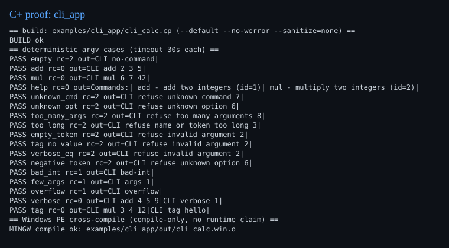

# CLI Application Suite

This is a real, verified C+ application suite (not a demo). Runner: `sh apps/cli_app/run.sh`.

Verified verdict: `CLI_APP_RESULT built=1 pass=17 fail=0 total=17 wincross=ok`.

Screenshot generated from an actual run:


A deterministic calculator CLI that exercises the full `cli.hp` surface:
command/option registration, `cli_parse`, status-code refusals, `cli_run`
dispatch and `cli_help` rendering. No clock, prompts, environment reads or
file I/O; every invocation has one exact expected stdout and exit code.

## Files

- `cli_calc.cp` — the C+ app.
- `run.sh` — self-contained build + exact-output harness (30s per case).
- `out/` — generated binaries/logs/expected files (gitignored).

## Build and verify

```sh
sh apps/cli_app/run.sh
```

Build line used (from repo root):

```sh
./build/c+ build apps/cli_app/cli_calc.cp --default --sanitize=none \
    -I. -o apps/cli_app/out/cli_calc -- build/libc/libcplus_hardened.a
```

## Commands / options

| Command | Effect |
| --- | --- |
| `add A B` | sum two bounded non-negative decimal integers |
| `mul A B` | multiply them; wide-checked for 32-bit overflow |
| `help` | print the generated help text |

Options: `--verbose` (flag), `--tag=NAME` (value). `cli.hp` treats any leading
`-` token as an option, so negative operands are refused as unknown options.

## Verified result

`CLI_APP_RESULT built=1 pass=17 fail=0 total=17 wincross=ok` — all 17 exact
stdout/exit-code cases pass, including empty argv, a hostile 10 KB argument,
unknown command/option, too many args, empty token, missing option value,
overflow and both valid command paths.

## Windows scope (compile-only)

`x86_64-w64-mingw32-gcc -x c -c -std=gnu17` compiles the same source text and
the real `stdlib/cli.hp` to an `Intel amd64 COFF` object. This is a compile-only
check. Highball/Wine execution is **blocked** in this environment, so no
Windows runtime success is claimed.

## Screenshot (generated from an actual runner transcript)



Transcript + verifier: [`proof/all_apps_games_screenshots/cli_app.md`](../../proof/all_apps_games_screenshots/cli_app.md).