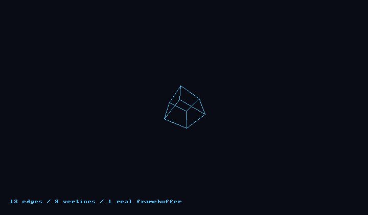

# games3d_real — real SDL3 3D renderer

Software-projected rotating wireframe cube rendered by SDL3 and captured from the framebuffer (720x420 PNG). Runner: `sh apps/games3d_real/run.sh` (`GAMES3D_REAL_TEST 2 2 0`). Not a CLI transcript.
