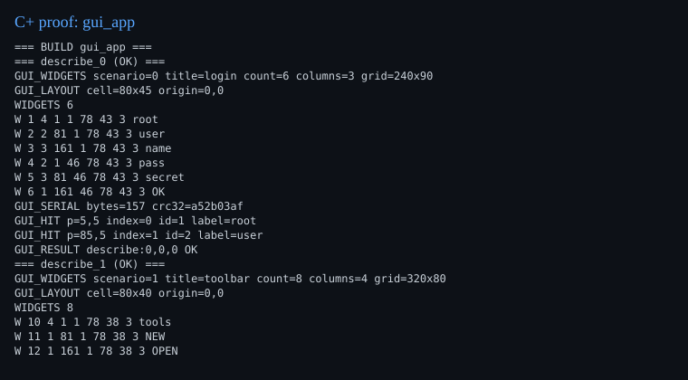

# gui_app — headless GUI-command suite (NOT a native GUI) — real GUI application (verified, not a demo)

This is a real, verified C+ application (not a demo). Runner: `sh apps/gui_app/run.sh`.

Verified verdict: `GUI_APP 30 6 0 24` — 6 successes, 24 defined refusals,
0 failures.

Screenshot generated from an actual run:



Transcript + verifier: [`proof/all_apps_games_screenshots/gui_app.md`](../../proof/all_apps_games_screenshots/real/gui_app_real.png).

A small, deterministic GUI **app** built on the new `stdlib/widgets.hp`
headless widget core and a real SDL3 window/renderer. It is a real verified
application with a reproducible refusal transcript, not a production window
application and not a memory-safety proof.

## What it actually does

`gui_app.cp` has one shared deterministic widget core and three commands:

| Command | Path | Output |
| --- | --- | --- |
| `describe <id>` | pure widget core, no SDL/display/clock/network | widget tree, layout, serialization, CRC32, two hit tests |
| `render <w> <h> <id>` | same core, then a real hidden SDL3 window + software renderer and one presented frame | the core transcript plus one `GUI_SDL ... driver=dummy` line |
| `refuse <case>` | fault injection through `error *` | a stable `GUI_REFUSED ...` line plus `GUI_RESULT ... REFUSED <code>` |

Three fixed scenarios are encoded as plain data: `login` (6 widgets, 3
columns), `toolbar` (8 widgets, 4 columns) and `dialog` (4 widgets, 2 columns,
one widget disabled before hit testing).

### widgets.hp APIs used

`stdlib_window_init`, `stdlib_widget_add`, `stdlib_widget_enable`,
`stdlib_window_layout`, `stdlib_window_hit_test`,
`stdlib_window_serialized_size`, `stdlib_window_serialize`,
`stdlib_window_drop`, plus the public kinds/flags
`STDLIB_WIDGET_{BUTTON,LABEL,INPUT,PANEL}`, `STDLIB_WIDGET_{ENABLED,VISIBLE}`
and `STDLIB_WIDGET_GRID_INSET`.

SDL3 is used **only** for the real headless frame (`SDL_Init`,
`SDL_CreateWindow` with `SDL_WINDOW_HIDDEN`, `SDL_CreateRenderer`,
`SDL_SetRenderDrawColor`, `SDL_RenderClear`, `SDL_RenderFillRect`,
`SDL_RenderPresent`, `SDL_GetCurrentVideoDriver`, cleanup). SDL never decides
the transcript. Every laid-out widget becomes an `SDL_FRect` drawn on that
frame.

### Output contract

```
GUI_WIDGETS scenario=<id> title=<name> count=<n> columns=<c> grid=<w>x<h>
GUI_LAYOUT cell=<w>x<h> origin=<x>,<y>
WIDGETS <count>
W <id> <kind> <x> <y> <w> <h> <flags> <label>        (one line per widget)
GUI_SERIAL bytes=<n> crc32=<8 lowercase hex>
GUI_HIT p=<x>,<y> index=<i> id=<id> label=<label>   (or: miss=1)
GUI_RESULT <tag> OK|REFUSED <code>
```

The CRC32 is reflected IEEE (polynomial `0xEDB88320`) over the exact bytes of
the serialization (excluding its terminating NUL). No pointers, wall clock,
locale, randomness or SDL state enter the checksum.

## Build and verify

From the repository root, after `build/c+` and
`build/libc/libcplus_hardened.a` exist:

```sh
sh apps/gui_app/run.sh
```

`run.sh` builds with the exact required command:

```sh
./build/c+ build apps/gui_app/gui_app.cp --default --sanitize=none -I. \
  $(pkg-config --cflags --libs sdl3) -o apps/gui_app/bin/gui_app \
  -- build/libc/libcplus_hardened.a
```

then runs 30 cases under `timeout 30` with `SDL_VIDEODRIVER=dummy`. Every case
must exit 0, write nothing to stderr, match a frozen expected stdout file byte
for byte, and produce byte-identical stdout on a second run. Its last line is
`GUI_APP <scenarios> <passed> <failed> <refused>`.

One extra case runs `describe 2` with `SDL_VIDEODRIVER` unset: the pure core
does not need a display at all.

## Windows PE check — compile only

`run_windows_cross.sh` validates `win_portability_probe.c`, a small plain-C
**mirror** of the deterministic core (grid layout, hit test, CRC32). It is not
the SDL3 layer, not the C+ lowering and not the app binary: mingw-w64 here has
no SDL3 headers and cannot parse C+ `.hp` headers. The probe is first compiled
and run natively to prove its CRC32 equals the app's (`a52b03af`), then
cross-compiled with `x86_64-w64-mingw32-gcc -c` and checked with `file` to be a
genuine COFF object.

**No Windows runtime success is claimed by this runner.** Its `-v` capture is
conservative and the final line's `runtime=BLOCKED` is a scope statement, not a
failure. A separate pack *does* execute PE32+ builds of this app under
Highball/Wine with the two MinGW runtime DLLs in place:
[`proof/real_apps_cross_platform/`](../../proof/real_apps_cross_platform/README.md)
reports `CROSS_PROOF 58 58 0` and records `GUI_RESULT describe:0,0,0 OK` on
both platforms. That evidence is host/engine-specific and does not change this
runner's compile-only Windows scope.

## Non-claims

- This is a deterministic teaching model with fixed argv scenarios. There is
  no interactive event loop, no wall clock, no network and no real user input.
- A clean build, a COFF object or a headless `SDL_VIDEODRIVER=dummy` frame is
  not live-display success, a memory-safety proof, or a production GUI
  toolkit.
- Results were recorded on macOS arm64 / SDL3 3.4.18 only (see
  [RESULTS.md](RESULTS.md)). No other platform, SDL3 version, video driver or
  renderer backend is claimed to behave identically.
- No Rust equivalence is claimed; Rust is not used here.

## Cross-platform screenshots (captured transcripts)

- macOS arm64: [gui_app-macos.svg](../../proof/real_apps_cross_platform/screenshots/gui_app-macos.svg)
- Windows PE32+ (Highball/Wine): [gui_app-windows.svg](../../proof/real_apps_cross_platform/screenshots/gui_app-windows.svg)

Full cross-platform proof:
[`proof/real_apps_cross_platform/`](../../proof/real_apps_cross_platform/README.md)
— `CROSS_PROOF 58 58 0`.

This runner verifies CLI-driven GUI command behavior only; no native window, widgets, textbox, list or dropdown is present. Screenshots are SVG transcript renderings.
