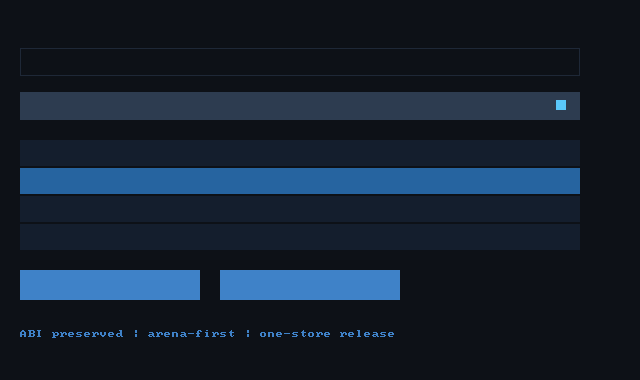

# gui_widgets — real SDL3 GUI app

Uses `stdlib/gfx_sdl3.hp` over SDL3 to render real widgets (textbox, dropdown, list, buttons) into a window, and saves the renderer framebuffer.

Runner: `sh apps/gui_widgets/run.sh` (`GFX_APP_TEST 3 3 0`). Headless verification uses `SDL_VIDEODRIVER=dummy`; this is real GUI renderer output, not a CLI transcript.
