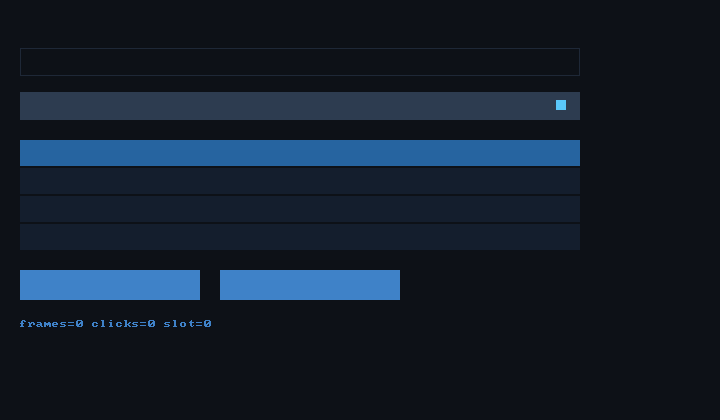

# memory_lab_gui — real interactive SDL3 GUI + scoped memory

Textbox, dropdown, selectable list and buttons. Transient frame data lives on the VM data stack via `stdlib_scoped_scope` (one-store release). Runner: `sh apps/memory_lab_gui/run.sh`; headless proof uses `SDL_VIDEODRIVER=dummy` and a real SDL3 framebuffer capture.
