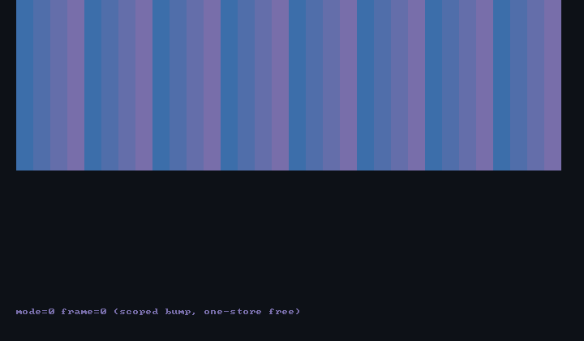

# sample_games_gui — real SDL3 GUI versions of the game workloads

Raycast room, block terrain and task list rendered in a real SDL3 window; transient frame data uses the C+ scoped data stack (one-store release). Runner: `sh apps/sample_games_gui/run.sh` (`SAMPLE_GAMES_GUI_TEST 2 2 0`).
