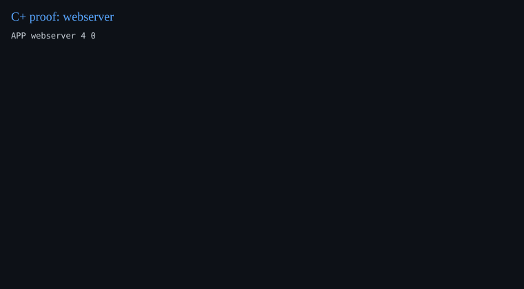

# webserver

## Screenshot (generated from an actual runner transcript)

Transcript + verifier: [`proof/all_apps_games_screenshots/webserver.md`](../../proof/all_apps_games_screenshots/webserver.md).
