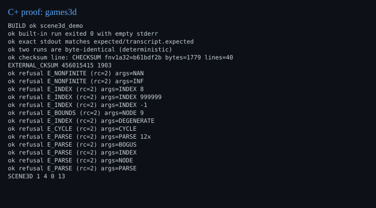

# games3d — deterministic 3D scene demo

A small, GPU-free "game engine" demo built entirely on the new additive
standard-library headers:

| header | role in this demo |
| --- | --- |
| `stdlib/math3d.hp` | `vec3`, `quat`, `mat4`: axis-angle → quaternion → rotation matrix, look-at / perspective cameras, and finite-input refusals |
| `stdlib/mesh3d.hp` | an 8-vertex / 12-triangle cube mesh, normals, validation, world-space AABBs and bad-index / degenerate-face refusals |
| `stdlib/scene3d.hp` | stable-index scene graph (root → platform → three cubes, plus a lights group), transforms, preorder traversal and cycle refusal |

## Files

- `scene3d_demo.cp` — the whole demo (built-in scene + hostile CLI).
- `expected/transcript.expected` — byte-exact golden stdout for the no-argv run.
- `run.sh` — builds with the supported driver, checks exact output,
  determinism, checksum and every refusal case. Final line:
  `SCENE3D 1 <passed> <failed> <refused>`.

## What it prints

The no-argv run renders a fixed transcript:

1. cube mesh stats, base AABB and validation report;
2. camera parameters and the perspective matrix's key entries;
3. a preorder node table with depth, child counts, world translations,
   world AABBs, centers and NDC screen projections;
4. a 32×16 top-down ASCII XZ occupancy grid (`A`/`B`/`C` for the cubes);
5. `CHECKSUM fnv1a32=<hex> bytes=<n> lines=<n>` — FNV-1a over every emitted
   transcript line — followed by `SCENE_DONE status=OK`.

All floats are printed at fixed precision with negative zero normalized, so
the transcript and its checksum are byte-for-byte reproducible.

## Hostile inputs

Every hostile command exits 2 and prints both a `REFUSE code=…` line and
`SCENE_DONE status=REFUSED code=…`:

| command | refused because | code |
| --- | --- | --- |
| `NAN` | NaN position fed to `vec3_add` | `E_NONFINITE` |
| `INF` | infinite rotation axis fed to `quat_from_axis_angle` | `E_NONFINITE` |
| `INDEX <n>` | `mesh3d_vertex_at` with an out-of-range vertex | `E_INDEX` |
| `NODE <n>` | `scene3d_node_child_at` with an out-of-range child | `E_BOUNDS` |
| `DEGENERATE` | `mesh3d_add_triangle` with a repeated index | `E_INDEX` |
| `CYCLE` | `scene3d_node_reparent` under a descendant | `E_CYCLE` |
| `PARSE <token>` | malformed numeric token | `E_PARSE` |

## Build / run

From the repository root:

```sh
examples/games3d/run.sh
```

`run.sh` uses exactly:

```
./build/c+ build examples/games3d/scene3d_demo.cp \
    --default --sanitize=none -I. -o examples/games3d/bin/scene3d_demo \
    -- build/libc/libcplus_hardened.a
```

Every run is bounded by `timeout 30`.

## C+ lowering notes

Two small workarounds for current C+ lowering quirks are intentional:

- arrays of struct types and the 2D grid use literal extents rather than
  macro expressions (macro extents get wrapped in an invalid
  `CPLUS_NONNULL(...)` declaration / a bogus runtime bounds check);
- NaN/Inf are produced by floating division rather than union type-punning,
  which the lifetime checker rejects.

`--default` mode reports these as warnings but does not fail the build.

## Screenshot (generated from an actual runner transcript)



Transcript + verifier: [`proof/all_apps_games_screenshots/games3d.md`](../../proof/all_apps_games_screenshots/games3d.md).
