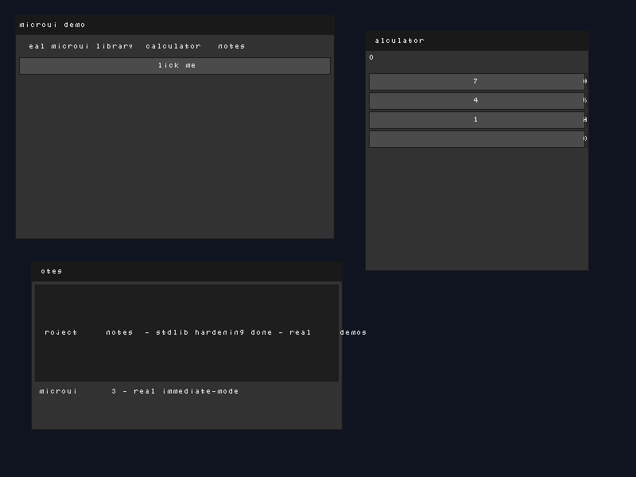

# Real microui GUI: calculator + notes

A genuine immediate-mode GUI app using the real [microui](https://github.com/rxi/microui)
library with a custom SDL3 renderer. The vendored library (`microui.c/.h`) is
upstream MIT-licensed code; see `UPSTREAM_README.md` and `LICENSE`.



## Demos included

- **Calculator** — working 4-function calculator (buttons, display, C/=).
- **Notes** — editable text box with sample content.
- **Demo window** — buttons and labels proving the immediate-mode event path.

## Design

- `microui_app.cp` — modern C+ app (class-based state), compiled with `--default`.
- `microui_backend.c` + `microui_api.h` — plain-C ABI wrapper around microui
  and SDL3, so the C+ analyser never parses third-party UI headers.
- `mu_font.h` — 6x6 bitmap font reused from the Olive demo (MIT upstream).

This is the same supported pattern as the Nuklear demo: prebuilt C libraries
are linked as-is through a C ABI boundary; no C ABI layout is changed.

## Run

```sh
sh examples/microui/run.sh
# MICROUI_TEST 7 7 0
```

Without `UI_PROOF`, a real 800x600 desktop window opens with all three panels.
