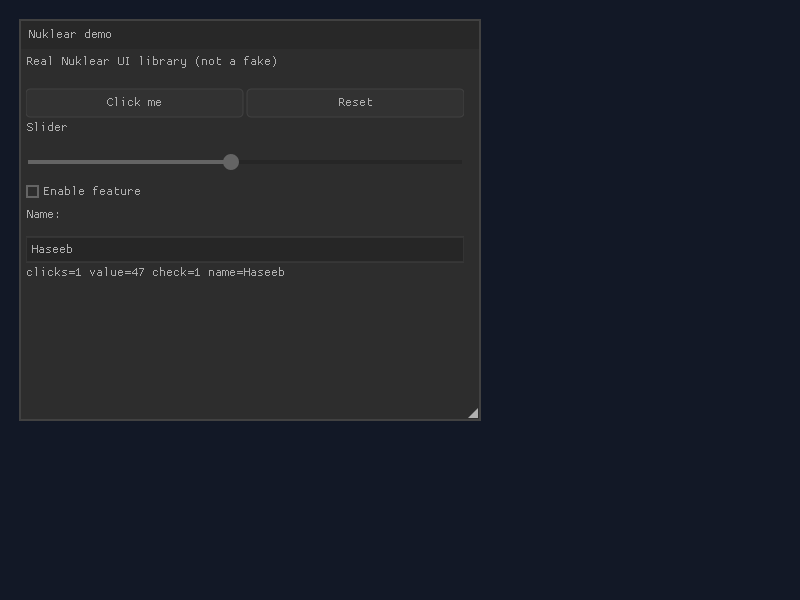

# Real Nuklear GUI app in modern C+

A genuine interactive GUI application using the **real Nuklear UI library**
(vendored in `third_party/nuklear/`) with its official SDL3 renderer backend.
No hand-rolled fake rectangles: the window below has real buttons, a slider,
a checkbox and an editable text field.



## Source layout

- `nuklear_gui.cp` - modern C+ app: a `class` wraps the GUI state, and all
  widgets are driven from methods. Compiled with `--default` (not `--legacy-c`).
- `nuklear_backend.c` - plain-C ABI wrapper around SDL3 and Nuklear.
- `nuklear_gui_api.h` - the small C ABI boundary between the two.

## Works with prebuilt C libraries

SDL3 and Nuklear are existing C libraries. The C+ app includes only the
local wrapper header, so the C+ analyser never parses third-party headers;
the prebuilt C objects are passed to the backend linker unchanged. This is
the supported pattern for using any already-compiled static (`.a`) or
dynamic (`.dylib`/`.so`) C library without changing its ABI.

## Run

```sh
sh examples/nuklear_gui/run.sh
# NUKLEAR_GUI_TEST 7 7 0
```

Without `GUI_PROOF`, the app opens a real 800x600 desktop window. Click the
buttons, drag the slider, edit the name; `Esc` or window close exits.
