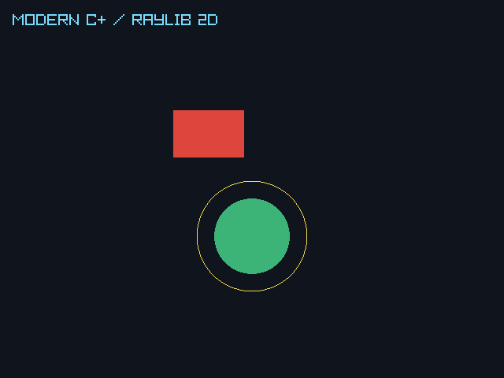
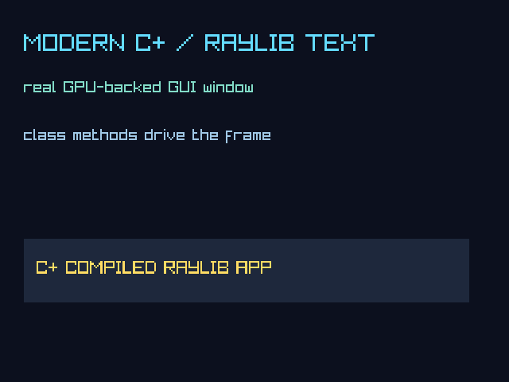
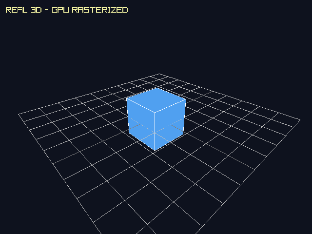

# Real raylib demos in modern C+

Three genuine GUI demos built with the C+ compiler in default (modern C+)
mode - not `--legacy-c`. Each uses C+ `class` state and methods, compiled
from a `.cp` source. These are real windowed / GPU-rendered applications.

## Screenshots (real framebuffer captures)







## Demos

- `shapes2d.cp` - real 2D window: moving box, circles, mouse/keyboard input.
- `text2d.cp` - real text rendering with the built-in raylib font.
- `cube3d.cp` - real GPU 3D: `BeginMode3D`, `DrawCube`, orbital camera, grid.

```sh
sh examples/raylib_demos/run.sh
# RAYLIB_DEMOS 12 12 0
```

## Linking prebuilt C libraries

These demos already link against the **prebuilt raylib 6.2 C libraries**
shipped in `examples/raylib/lib/` - both the static archive
(`libraylib.a`) and the dynamic shared library (`libraylib.6.2.0.dylib`).
No raylib source is recompiled and no vendor source is modified: the C+
driver passes the library and `-L`/`-l`/`-Wl,-rpath` flags through to the
backend linker unchanged, so an existing C ABI library works out of the box.

To choose the static archive explicitly, name the file after `--`:

```sh
build/c+ build shapes2d.cp --default --sanitize=none -I. -I../raylib/include \
  -o out/shapes2d -- ../raylib/lib/libraylib.a \
  -framework Cocoa -framework OpenGL -framework GLUT \
  -framework CoreVideo -framework IOKit -framework QuartzCore
```

The same mechanism works for any prebuilt static (`.a`) or dynamic
(`.dylib`/`.so`) C library: pass `-L<dir> -l<name>` for the link stage, or
the bare archive path after `--`. The compiler never lowers a library as
C+ source, so third-party C ABIs stay intact.

## Exact commands (from repository root)

Prerequisite: raylib is vendored in `examples/raylib/` (headers in `include/`,
`libraylib.a` and `libraylib.6.2.0.dylib` in `lib/`). SDL3 is not needed here.

```sh
export PATH=/usr/bin:/bin:/usr/sbin:/sbin:/opt/homebrew/bin:$PATH
unset SDKROOT
C=build/c+   # or build-alpha/c+
RL=examples/raylib
RP=$(cd "$RL/lib" && pwd)

# Build one demo (modern C+, real .cp):
$C build examples/raylib_demos/shapes2d.cp --default --sanitize=none \
  -I. -I"$RL/include" -o /tmp/shapes2d -- -L"$RL/lib" -Wl,-rpath,"$RP" \
  -lraylib -framework CoreVideo -framework IOKit -framework Cocoa \
  -framework QuartzCore -framework GLUT -framework OpenGL \
  -Wno-unused-command-line-argument

# Run it:
RAYLIB_PROOF=1 /tmp/shapes2d     # deterministic PNG proof in out/
/tmp/shapes2d                    # real interactive GUI window

# Run all three demos with verification:
sh examples/raylib_demos/run.sh  # RAYLIB_DEMOS 12 12 0
```

`cube3d.cp` uses the same command with the source name changed; it renders
real GPU 3D via `BeginMode3D`/`DrawCube`.
