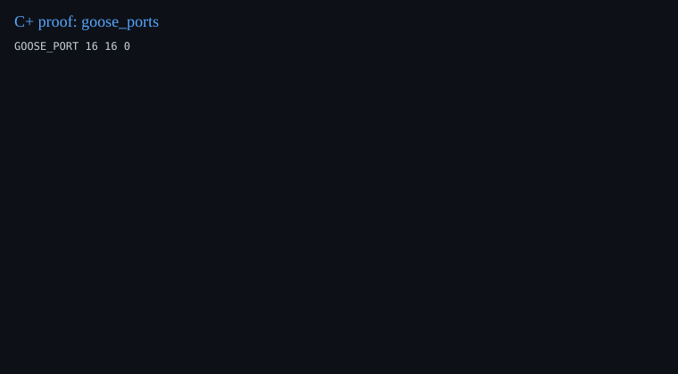

# modern_c_ports screenshot

Runner: `proof/modern_c_ports/run.sh`. Generated from its actual stdout (bounded by timeout).

Transcript: [`screenshots/modern_c_ports.out`](screenshots/modern_c_ports.out).
