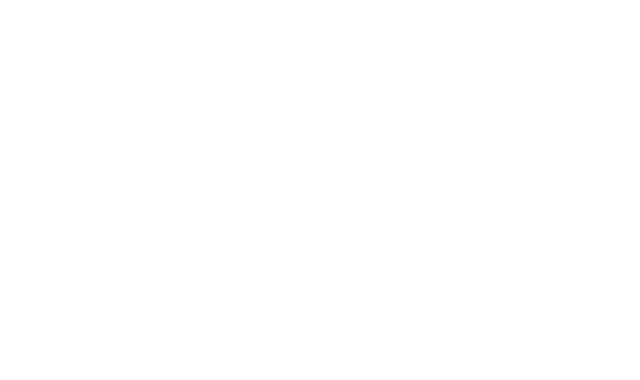

# nuklear screenshot

Runner: `proof/games_gui_nuklear/run.sh`. Generated from its actual stdout (bounded by timeout).

Transcript: [`screenshots/nuklear.out`](screenshots/nuklear.out).

Proof image is a real SDL3 framebuffer capture, not a CLI transcript.
