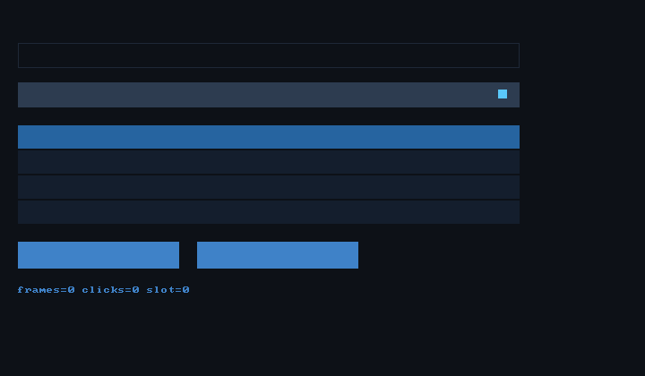

# scoped_memory screenshot

Runner: `examples/scoped_memory/run.sh`. Generated from its actual stdout (bounded by timeout).

Transcript: [`screenshots/scoped_memory.out`](screenshots/scoped_memory.out).

Proof image is a real SDL3 framebuffer capture, not a CLI transcript.
