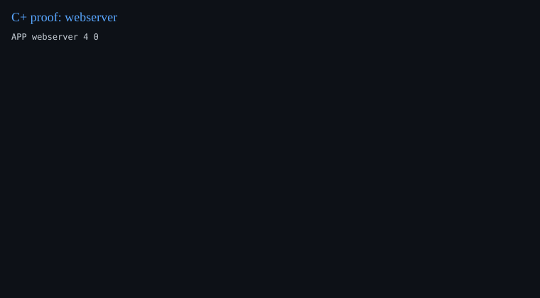

# webserver screenshot

Runner: `apps/webserver/run.sh`. Generated from its actual stdout (bounded by timeout).

Transcript: [`cli_transcripts/webserver.out`](cli_transcripts/webserver.out).

This is a CLI transcript rendered as SVG, NOT a GUI or 3D screenshot.
