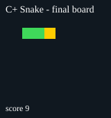

# snake — screenshot and proof

Built and verified by `sh proof/games_gui_nuklear/run.sh` → `GAME_SUITE 4 4 0`.
Source: `game_suite.cp`; binary: `bin/game_suite`; transcript: `expected/stdout.txt`.
